 

  

---

## 👋 About Me

I'm **Iram Hussain** (he/him), a fourth-year **B.Tech Computer Science Engineering** student at **Integral University, Lucknow**, and a **Machine Learning Intern** at **Cloud Nebula Enterprises Pvt. Ltd.**

- 🤖 Aspiring **Data Scientist** focused on practical, data-driven AI systems.
- 🛠️ Building an end-to-end **Industrial Predictive Maintenance System** for equipment-failure forecasting.
- 🧠 Interested in machine learning, deep learning, neural networks, computer vision, and model optimization.
- 📍 Based in **Lucknow, Uttar Pradesh, India**.
- 🌱 Turning theoretical ML concepts into reliable, real-world software solutions.

> **"Consistency is the key."**

## 💼 Experience & Education

| Area | Details |
|---|---|
| 💻 Current Role | Machine Learning Intern — **Cloud Nebula Enterprises Pvt. Ltd.**, Lucknow |
| 🎓 Education | B.Tech in Computer Science Engineering, 4th Year — **Integral University** |
| 📜 Certification | *The Ultimate Job Ready Data Science Course* — Code With Harry |
| 🎯 Career Goal | Data Scientist |

## 🚀 Featured Projects

| Project | Description |
|---|---|
| [Industrial Predictive Maintenance System](https://github.com/hussainiram0601-lang/Industrial-Predictive-Maintenance-System) | An end-to-end ML pipeline to forecast industrial equipment failures through data cleaning, time-series feature engineering, imbalance-aware modeling, and business-cost optimization. |
| [Notzy – AI Study Buddy](https://strict-canvas-creator.lovable.app) | An AI study companion with automated PDF chunking, mock-exam generation, and real-time text-to-Mermaid flowchart rendering. Built with React, TypeScript, Supabase Edge Functions, Gemini, Groq, and OpenRouter. |
| [ANN for Customer Churn Modelling](https://github.com/hussainiram0601-lang/Artificial-Neural-Network-ANN-for-Churn-Modelling-project) | A deep-learning neural-network model for customer churn prediction and business analytics. |
| [CNN Image Classification](https://github.com/hussainiram0601-lang/Convolutional-Neural-Network-CNN-image-classification-project) | A Convolutional Neural Network for image-classification tasks and computer-vision learning. |
| [K-NN Classification — 93% Accuracy](https://github.com/hussainiram0601-lang/New-Project-Completed-Achieving-93-Neighbors-K-NN-) | A tuned K-Nearest Neighbors classifier using feature scaling and Minkowski-distance calibration. |
| [SVM Hyperparameter Optimization](https://github.com/hussainiram0601-lang/grid_Search-technique-to-optimize-SVM-model) | An SVM optimization workflow using GridSearchCV, cross-validation, and parameter tuning. |

## 🧰 Tech Stack

  

## 🧠 Areas I Work With

- **Machine Learning:** Classification, regression, clustering, model evaluation, cross-validation, GridSearchCV, and feature engineering.
- **Deep Learning:** Artificial neural networks, CNNs, TensorFlow, Keras, and transfer learning.
- **Data Science:** Exploratory data analysis, dimensionality reduction, association rules, and predictive analytics.
- **Model Optimization:** Scaling, preprocessing, pipeline design, hyperparameter tuning, and imbalance-aware modeling.

---

## 👾 Pac-Man Contribution Graph

Watch Pac-Man explore my GitHub contribution history!

<picture>
  <source media="(prefers-color-scheme: dark)" srcset="https://raw.githubusercontent.com/hussainiram0601-lang/hussainiram0601-lang/output/pacman-contribution-graph-dark.svg">
  <source media="(prefers-color-scheme: light)" srcset="https://raw.githubusercontent.com/hussainiram0601-lang/hussainiram0601-lang/output/pacman-contribution-graph.svg">
  
</picture>

<h2 align="center">📈 GitHub Activity Graph</h2>

  

<h2 align="center">⚡ GitHub Analytics</h2>

  

---

## 🤝 Let's Connect

I'm open to **data-science internships, entry-level opportunities, AI/ML collaborations, and open-source contributions**.

<a href="mailto:hussainiram0601@gmail.com">📫 Email Me</a> ·
<a href="https://www.linkedin.com/in/iram-hussain-165594397/">💼 LinkedIn</a> ·
<a href="https://leetcode.com/u/iram_hussain07/">🧩 LeetCode</a> ·
<a href="https://github.com/hussainiram0601-lang">🐙 GitHub</a>

  

### ✨ Keep Learning. Keep Building. Keep Growing. ✨

