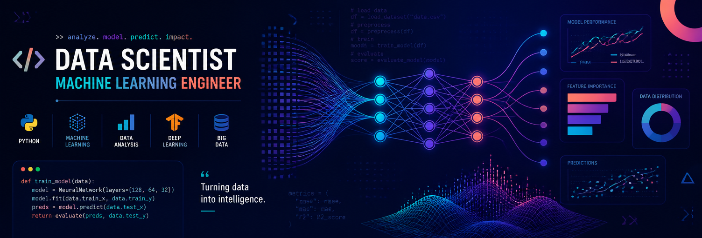

  

  # Hi there, I'm **Iram Hussain** 👋

  ### `Aspiring Data Scientist` | `Machine Learning Enthusiast` | `Deep Learning Practitioner`

  *Pronouns: he/her* 🌈

  
  
  
  
  

---

## 🚀 About Me

> I'm **Iram Hussain**, a 4th-year B.Tech Computer Science student at **Integral University, Lucknow, Uttar Pradesh**, India. I am passionate about transforming raw data into meaningful intelligence and building **machine learning** and **deep learning** solutions that solve real-world problems.

I genuinely enjoy working on projects involving **neural networks**, **predictive maintenance**, **computer vision**, and **model optimization**. Currently, I'm focused on building production-ready ML systems and transitioning theoretical concepts into deployable software solutions.

🌟 *Motto: **"Consistency is the key."***

---

## 🛠️ Tech Stack & Tools

### 💻 Languages

### 🤖 Machine Learning & Deep Learning

### 🌐 Web & Tools

---

## 🔥 Featured Projects

| Project | Description | Impact |
|---------|-------------|--------|
| [**Industrial Predictive Maintenance System**](https://github.com/hussainiram0601-lang/Industrial-Predictive-Maintenance-System) | ML pipeline for forecasting industrial equipment failures using telemetry data, time-series feature engineering, and class-imbalance-aware modeling. | Real-world industrial problem-solving; minimizes unscheduled downtime. |
| [**ANN for Churn Modelling**](https://github.com/hussainiram0601-lang/Artificial-Neural-Network-ANN-for-Churn-Modelling-project) | Deep learning neural network for customer churn prediction. | Demonstrates neural network architecture for business analytics. |
| [**K-NN 93% Accuracy**](https://github.com/hussainiram0601-lang/New-Project-Completed-Achieving-93-Neighbors-K-NN-) | K-Nearest Neighbors classification with well-tuned hyperparameters. | Achieved **93% accuracy** on test data. |
| [**CNN Image Classification**](https://github.com/hussainiram0601-lang/Convolutional-Neural-Network-CNN-image-classification-project) | Convolutional Neural Network for image classification tasks. | Showcases computer vision and neural network design skills. |
| [**GridSearch SVM Optimization**](https://github.com/hussainiram0601-lang/grid_Search-technique-to-optimize-SVM-model) | Hyperparameter tuning for Support Vector Machines using GridSearchCV. | Advanced model tuning and optimization techniques. |

---

## 🏢 Experience

### 🔬 Machine Learning Intern
**Cloud Nebula Enterprises Pvt. Ltd.** — *Lucknow Branch*  
Working under Senior Research Management, focusing on industry-scale AI models and deployment pipelines.

---

## 🎓 Education & Certifications

- **🎓 B.Tech in Computer Science Engineering (4th Year)**  
  **Integral University**, Lucknow, Uttar Pradesh, India

- **📜 The Ultimate Job Ready Data Science Course**  
  Authorized by **Code With Harry**  
  *Core Competencies:* Advanced Data Preprocessing, Supervised & Unsupervised Learning, Statistical EDA

---

## 🌱 Currently Building

### 🔧 Industrial Predictive Maintenance System
An end-to-end Machine Learning pipeline designed to forecast industrial equipment failures using longitudinal telemetry data. It includes:
- Advanced data cleaning
- Time-series feature engineering
- Class-imbalance-aware modeling
- Business-cost optimization to minimize unscheduled downtime

---

## 💡 Areas of Expertise

- **Machine Learning & Model Optimization** — GridSearchCV, SVM, XGBoost, K-Means, model evaluation, cross-validation
- **Deep Learning & Neural Networks** — CNN, ANN, Keras, TensorFlow, transfer learning
- **Data Science & Analytics** — PCA, LDA, clustering, regression, classification, feature engineering
- **Data Processing** — Pandas, NumPy, data visualization with Matplotlib, train-test splitting, scaling
- **Python & Scikit-learn** — Pipelines, model selection, validation metrics, confusion matrix analysis

---

## 📊 GitHub Stats

  
  

---

## 📬 Let's Connect!

I'm open to **Data Scientist roles**, internships, collaborations, and mentoring opportunities.

- 📧 **Email:** [hussainiram0601@gmail.com](mailto:hussainiram0601@gmail.com)
- 💼 **LinkedIn:** [linkedin.com/in/iram-hussain-165594397](https://www.linkedin.com/in/iram-hussain-165594397/)
- 🧠 **LeetCode:** [leetcode.com/u/iram_hussain07](https://leetcode.com/u/iram_hussain07/)
- 🌐 **Portfolio:** [strict-canvas-creator.lovable.app](https://strict-canvas-creator.lovable.app)

---

  ### ✨ *Consistency is the key.* ✨

  

